

<a href="https://github.com/athatheo/athatheo/tree/main/story"><picture><source media="(prefers-reduced-motion: reduce)" srcset="assets/story-still.png"></picture></a>

<a href="https://x.com/atha_theo#gh-dark-mode-only"><picture><source media="(max-width: 600px)" srcset="assets/hero-narrow-dark.svg"></picture></a>
<a href="https://x.com/atha_theo#gh-light-mode-only"><picture><source media="(max-width: 600px)" srcset="assets/hero-narrow-light.svg">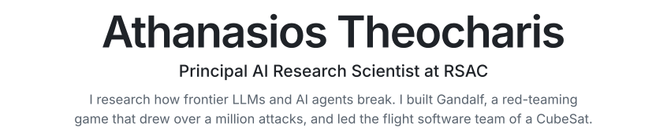</picture></a>

<h3 align="center">Research</h3>

<a href="https://arxiv.org/abs/2508.06394"><picture><source media="(prefers-color-scheme: dark)" srcset="assets/research-aiops-dark.svg">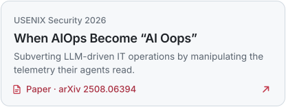</picture></a>
<a href="https://arxiv.org/abs/2501.07927"><picture><source media="(prefers-color-scheme: dark)" srcset="assets/research-gandalf-red-dark.svg">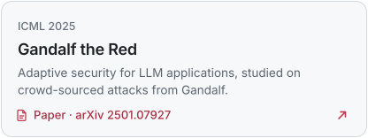</picture></a>
<a href="https://www.rsaconference.com/library/blog/human-experts-cant-beat-most-llms-at-a-cybersecurity-knowledge-competition"><picture><source media="(prefers-color-scheme: dark)" srcset="assets/research-llms-vs-experts-dark.svg">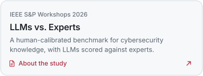</picture></a>
<a href="https://www.rsaconference.com/Library/presentation/USA/2025/Humans%20vs%20AI%20-%20Insights%20from%20a%20Cybersecurity%20Quiz%20Battle"><picture><source media="(prefers-color-scheme: dark)" srcset="assets/research-humans-vs-ai-dark.svg">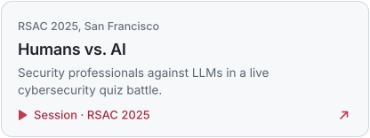</picture></a>

<h3 align="center">Projects</h3>

<a href="https://gandalf.lakera.ai"><picture><source media="(prefers-color-scheme: dark)" srcset="assets/project-gandalf-dark.svg">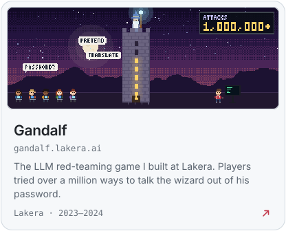</picture></a>
<a href="https://gitlab.com/acubesat"><picture><source media="(prefers-color-scheme: dark)" srcset="assets/project-acubesat-dark.svg">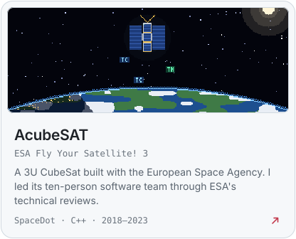</picture></a>

<a href="https://github.com/athatheo/tri-bonsai"><picture><source media="(prefers-color-scheme: dark)" srcset="assets/repo-tri-bonsai-dark.svg">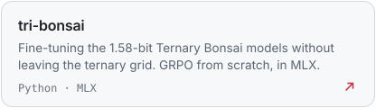</picture></a>
<a href="https://github.com/athatheo/bonsai-fold"><picture><source media="(prefers-color-scheme: dark)" srcset="assets/repo-bonsai-fold-dark.svg">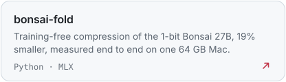</picture></a>
<a href="https://github.com/Sombrace/BoBe"><picture><source media="(prefers-color-scheme: dark)" srcset="assets/repo-bobe-dark.svg">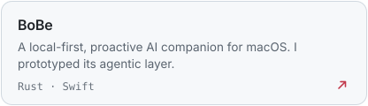</picture></a>
<a href="https://github.com/AcubeSAT/ecss-services"><picture><source media="(prefers-color-scheme: dark)" srcset="assets/repo-ecss-services-dark.svg">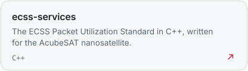</picture></a>

<a href="https://x.com/atha_theo">X</a> · <a href="https://gitlab.com/athatheo">GitLab</a> · <a href="mailto:athatheoc@gmail.com">Email</a> · <a href="https://github.com/athatheo/athatheo/blob/main/HOW-IT-WORKS.md">How this page works</a>

